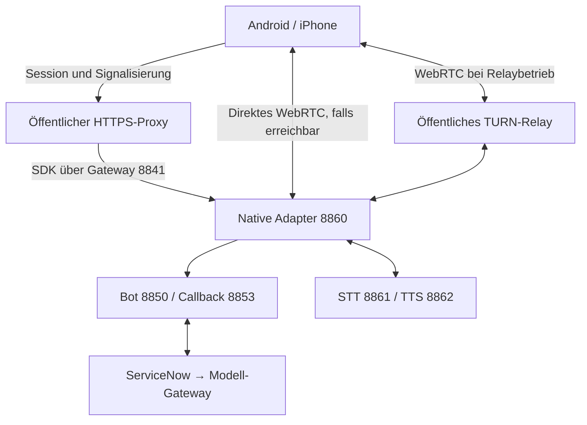

# ServiceNow Local Voice 2.0 – Installation auf einer neuen Instanz

Stand: 19.10.2026. Diese Anleitung beschreibt den vorhandenen öffentlichen Paketstand und die zusätzlich erforderliche Betreiberkonfiguration. Ein Import auf einer frischen Zielinstanz sowie die aktuelle Audioabnahme mit physischen Android- und iOS-Geräten sind noch nicht nachgewiesen. Der gemeldete Fehler „keine Begrüßung über 5G/externes Netz“ ist damit **nicht als behoben** erklärt.

Das Paket ist wiederverwendbar, aber kein vollständiger Installer. Es enthält einen nativen ServiceNow-XML-Batch, den unveränderten bisherigen Host-Quelloverlay unter `host-overlay/` und die zusätzliche geprüfte Host-Relay-Erweiterung unter `relay-overlay/`. Produktvoraussetzungen, Credentials, private Bindungen, Modelllaufzeit und öffentliche Netzwerkwege sind separat einzurichten.

## 1. Zuständigkeiten

| Einstellung | Maßgebliche Oberfläche |
| --- | --- |
| Custom-LLM-Provider, Modell, Modellkennung, Verbindungsalias und Fähigkeiten | AI Control Tower / native Custom-LLM-Konfiguration |
| Skill, Promptvorlage und -rolle, Variablen, Validatoren, Antwortschema und Inferenzparameter | Skill Kit / zugehörige native AI-Konfiguration |
| Assistant-Beschreibung/Systemanweisung, erste/weitere Sprachen, Begrüßung, Sprachwahl, Abschluss und Sprechvorgaben | Nativer Voice Assistant |
| Zielinstanz, private Endpunkte, Credentials und Voice–NAVA–Profilzuordnung | Private Konfiguration der Zielinstanz |
| Gewichte, Enginebuild, Kontextkapazität, Speichergrenzen und Prozesse | Betreiberprofil des lokalen Modellhosts |
| STT, TTS, aktive Referenz-/Custom-Stimme und VoiceStudio | Bestehender Sprachhost; diese Komponenten werden durch 2.0 nicht ersetzt |

Der Modelladapter darf keine feste deutsche Sprachvorgabe als Ersatz für die Voice-Einstellungen erhalten. Übertragene Voice-Felder sind nicht automatisch implementierte Funktionen: Telefonie, Transfer, MFA, Noise-Verarbeitung, DTMF, Cloud-Stimmkennungen und Phoneme brauchen gegebenenfalls einen passenden Transport oder Verbraucher. Einzelheiten stehen in `docs/parameter-matrix-current.json`.

Die bestehende native TTS-Engine ist derzeit mit Deutsch als Startsprache konfiguriert. Eine zweite Sprache im Voice Assistant beweist deshalb keine mehrsprachige Synthese. TTS/STT und Custom-Stimme bleiben unverändert; zusätzliche Sprachen müssen mit der tatsächlich eingesetzten Engine gesondert qualifiziert werden.

## 2. Lieferumfang prüfen

Entpacken Sie `ServiceNow-Voice-2.0-Paket-20261019.zip`. Verwenden Sie die eine XML unter `updatesets/`, die Dokumentation unter `docs/`, den bisherigen Quelloverlay unter `host-overlay/` und anschließend die gesondert manifestierte Erweiterung unter `relay-overlay/`. Die beiden Quellstände nicht als alternative Komplettinstallationen behandeln.

| Merkmal | Paketstand |
| --- | --- |
| XML-Datei | `ServiceNow-Voice-2.0-Konsolidiert-20261019.xml` |
| XML-Größe | 5.028.890 Bytes |
| XML SHA-256 | `7cce5efc22353bb64f5f3ef36de54d4092c3d7c59dc961bfe8d412647b6e7003` |
| Native Hierarchie | 31 eindeutige Update Sets; 32 serialisierte Header wegen einer identischen Root-Wiederholung |
| Customer Updates | 812, davon 783 unterschiedliche CU-Namen |
| Überschneidungen | 29 zusätzliche Versionsvorkommen zu 26 geteilten CU-Namen |
| Familien | Infrastructure 1.0, Validation 1.0.1, Core 1.1, Gemma 1.2, Foundation 1.0, Voice 1.3 |
| Bisheriger Host-Overlay | `host-overlay/`: unverändert 39 Dateien, darunter acht Runtime-Dateien |
| Separate Relay-Erweiterung | `relay-overlay/`: private hostseitige TURN-Konfiguration, Tests und minimaler Smoke-Loader-Patch |
| Host-Basisrevision | `af7845c53d1185d364a3d2a17ff28f9266d82215` |
| Automatisches Host-Apply | Gesperrt; `automaticHostApplyEnabled=false` |

Beispiel in PowerShell mit eigenem Entpackpfad:

```powershell
$PackageRoot = 'D:\Deploy\ServiceNow-Voice-2.0-Paket-20261019'
$XmlPath = Join-Path $PackageRoot 'updatesets\ServiceNow-Voice-2.0-Konsolidiert-20261019.xml'
(Get-Item -LiteralPath $XmlPath).Length
(Get-FileHash -LiteralPath $XmlPath -Algorithm SHA256).Hash.ToLowerInvariant()
```

Die übrigen Dateihashes stehen in `PACKAGE-MANIFEST.json` und `SHA256SUMS.txt`. Bei Abweichungen zuerst die Paketquelle klären. Das XML nicht nachträglich bereinigen, zusammenkopieren oder mit instanzspezifischen Werten ergänzen.

Nicht enthalten sind Modellgewichte, Binaries, Python-Umgebungen, Credentials, private Voice-/Profilbindungen, Referenzaufnahmen, betriebsfertiges DNS/TLS oder ein tatsächlich bereitgestellter TURN-Dienst. Die hostseitige TURN-Unterstützung ist als separater Quelloverlay enthalten; Relayendpoint und Credentials müssen vom Betreiber kommen. 17 geschützte native Kompatibilitätseinträge sind bewusst ausgeschlossen.

## 3. Zielinstanz vorbereiten

Beginnen Sie mit einer separaten Testinstanz und einem Administrator für Installation und Preview. Für den späteren Betrieb gelten die nativen Ausführungsrechte; zusätzliche Endanwenderrollen ersetzen keine korrekte Voice-/Agent-Bindung.

1. Zielrelease, Patchstand, Store-App-Versionen und Lizenzen dokumentieren.
2. Voice Agents, AI Agents, Virtual Agent/NAVA, Custom LLM/Generative AI Controller, AI Control Tower und Skill Kit müssen in einer kompatiblen Kombination verfügbar sein.
3. Verwendete Skills und ihre Produkte installieren/lizenzieren. Enthaltene HR-/Catalog-/Search-Metadaten setzen die zugehörigen nativen Komponenten voraus.
4. Für den mobilen Einsatz Now Mobile und den vorgesehenen Voice-Einstieg auf beiden Plattformen bereitstellen.
5. Unterstützte native OAuth-/Voice-Autorisierung und eine dedizierte Bot-Integration vorbereiten. Die Bridge arbeitet mit der konfigurierten Integrationsidentität; sie stellt keine beliebige Benutzerimpersonation bereit.
6. Bestehende Zieländerungen sichern und den Rückweg für Instanz und Host festlegen.

Der Paketkatalog enthält diese beobachteten Quellstände. Sie sind **keine zugesicherten Mindestversionen**:

| Anwendung / Scope | Beobachtete Version |
| --- | --- |
| ServiceNow Otto AI Agents / `sn_aia` | 9.0.11 |
| ServiceNow Otto for AI Search / `sn_ais_assist` | 18.0.5 |
| Service Catalog AI Core / `sn_catalog_ai_core` | 1.1.3 |
| Recommended Actions for Service / `sn_cs_nb_action` | 30.0.1 |
| Generative AI Controller / `sn_generative_ai` | 15.0.3 |
| AI Agents for HR Service Delivery / `sn_hr_ai_agents` | 7.3.1 |
| Now Mobile / `sn_me` | 30.1.2 |
| ServiceNow Otto for Virtual Agent / `sn_nowassist_va` | 22.0.18 |
| ServiceNow Otto Conversational Data Collection / `sn_vad_genai` | 10.2.22 |
| ServiceNow Otto for Voice Agents / `sn_voice_aia` | 6.0.5 |

Store-Namen und Lizenzangebote können sich ändern. Exakte installierbare App-/Plugin-Kennungen und Entitlements sind auf der Zielinstanz beziehungsweise mit dem ServiceNow-Vertrag zu prüfen; das Paket liefert keine vollständige Lizenz-/Plugin-Matrix.

Native Provider, Mappings, Capabilities, Definition-Kategorien, Truncate-Strategien, Flows und Validatoren sind nicht pauschal mitexportiert. Zwei native Parent-AI-Konfigurationen der Foundation sind externe Voraussetzungen; ihre Namen sind aus dem Export nicht verfügbar. Die Preview muss diese Referenzen auflösen. Fehlende native Parents nicht durch leere Platzhalter ersetzen oder per globaler XML-Suche umbiegen.

## 4. XML importieren und den gesamten Batch prüfen

ServiceNow dokumentiert den [XML-Import](https://developer.servicenow.com/blog.do?p=%2Fpost%2Fbackup-your-pdi%2F), die [Batch-Preview](https://www.servicenow.com/docs/r/application-development/system-update-sets/us-hier-preview.html) und den [Batch-Commit](https://www.servicenow.com/docs/r/application-development/system-update-sets/us-hier-commit.html). Nutzen Sie die zur Zielversion passende Dokumentation.

1. **All → System Update Sets → Retrieved Update Sets** öffnen.
2. Unter Related Links **Import Update Set from XML** wählen.
3. Die eine konsolidierte XML auswählen und **Upload** ausführen. Hier nicht die ZIP hochladen.
4. Batch Base **Custom LLM Voice 2.0 - Consolidated 20261019** öffnen.
5. Parent-/Batch-Base-Hierarchie und die sechs Familien kontrollieren. Die identische Root-Wiederholung in der Serialisierung ist kein zusätzlich zu importierendes Set.
6. Am Base-Datensatz **Preview Update Set Batch** starten. Keine feste Reihenfolge einzelner Teilimporte konstruieren.
7. **Preview Problems for Batch** öffnen. Fehlende Tabellen, Anwendungen, Referenzen, Scope-/Zugriffsprobleme und Kollisionen prüfen.
8. Besonders die 26 geteilten CU-Namen mit 29 zusätzlichen Versionsvorkommen prüfen. Diese Paketstatistik sagt nicht voraus, dass genau 29 Preview-Probleme auftreten.
9. Je Konflikt Zielbestand, angebotene Versionen und fachliche Absicht vergleichen. `docs/final-source-hashes.json` benennt den finalen eigenen Code einschließlich `CustomLLMPromptMirror` und enthält DE/EN-Abgleichhinweise. Keine pauschale Konfliktentscheidung treffen.
10. Fehlende native Produktvoraussetzungen durch passende Anwendungen/Versionen klären. Berechtigte Zielanpassungen und ihre Auflösung dokumentieren.
11. Mit **Run Preview Again for Batch** wiederholen, bis keine ungeklärten blockierenden Probleme verbleiben.
12. Erst danach am Base-Datensatz **Commit All Update Sets** wählen.
13. Commit-Ergebnis, tatsächliche Set-/CU-Zahlen, aufgelöste Probleme und Smoke-Prüfung dokumentieren.

ServiceNow bestimmt die Batch-Reihenfolge anhand von Änderungsdaten und Herkunft. Kinder aus dem Batch zu lösen verändert den geprüften Lieferzusammenhang. Die Offline-Prüfung des XML ersetzt keine Ziel-Preview.

## 5. Zielinstanz privat konfigurieren

### 5.1 Eigener Capture-Kontext

Öffentliche Release-Sets bleiben abgeschlossen. Für Zielbindungen einen privaten, nicht zu veröffentlichenden Capture-Kontext verwenden. Der Voice–NAVA-Helper prüft:

- Name beginnt mit `LOCAL ONLY`; Status `In progress`.
- Kein Parent und kein Base-Update-Set eingetragen.
- Dieses Set ist aktuell ausgewählt.
- Aktueller Anwendungsscope und Scope des Sets stimmen überein.
- `sn_voice_aia.local_llm.private_update_set` verweist auf dieses Ziel-Set.

Diese Property privat auf der Zielinstanz einrichten; keine Quellwerte übernehmen. Verweigert der Helper eine Änderung, zuerst den privaten Kontext und die native Zugriffsberechtigung korrigieren.

### 5.2 Modell und Skills

1. In AI Control Tower die importierten eigenen Custom-LLM-Konfigurationen prüfen.
2. Den logischen Verbindungsalias der gewünschten Modellkonfiguration mit einer **neuen Zielverbindung** verbinden: öffentliche HTTPS-Modellroute, Authentisierung und privates Credential.
3. Aktive Modellkennung mit `/v1/models` des tatsächlich gestarteten Gateways abgleichen. Keinen historischen Dateinamen als Beweis verwenden.
4. Kontext-/Ausgabelimit und Fähigkeiten mit dem Betreiberprofil abgleichen. Gemma verwendet im Referenzstand 32.768 Kontexttokens; ein Skillparameter vergrößert die Hostkapazität nicht.
5. Definitionen, Capability- und Prompt-Konfigurationen der Skills dem vorgesehenen Modell/Transformer zuordnen.
6. Im Skill Kit Rolle, gerenderten Prompt, Variablen, Validatoren, Schema und Parameter prüfen. Das native NameValue-Antwortschema wird einmal dekodiert; kein zusätzliches JSON-Escaping hinzufügen.
7. Einen harmlosen Texttest durchführen. Temperatur 0 muss 0 bleiben; nicht unterstützte Optionen müssen sichtbar fehlschlagen.
8. Andere Modelle benötigen ein qualifiziertes Transport-/Fähigkeitsprofil. Der historische Halogen-Transformer ist kein automatisch migrierter Universaladapter.

### 5.3 Voice Assistant und NAVA

1. Nativen Voice Assistant öffnen beziehungsweise zielgerecht konfigurieren.
2. Beschreibung/Systemanweisung, erste und weitere aktive Sprachen, Reihenfolge, Begrüßung, Auswahltexte, Abschluss und unterstützte Gesprächsparameter dort pflegen.
3. Passenden aktiven Voice-Agenten und sein Ausführungsrecht nativ zuordnen.
4. Einen dedizierten aktiven **Now Assist with Virtual Agent**-Deployment-Kontext (NAVA) für den lokalen Bot-Ausführungspfad vorbereiten.
5. In der Voice-Deployment-Konfiguration **Local LLM execution profile** (`u_local_llm_execution_profile`) auf den Kontext dieses NAVA-Deployments setzen. Falls das Feld im Formular fehlt, über die native Formkonfiguration sichtbar machen.
6. Das Profil muss eindeutig sein: ein passendes aktives NAVA-Deployment und keine zweite Voice-Konfiguration mit demselben lokalen Ausführungsprofil.
7. Im privaten Capture-Kontext speichern. **Guard local LLM Voice execution mapping** und **Sync local LLM Voice execution mapping** verwenden `LocalLLMVoicePersonaRouteSync`.
8. Prüfen, dass die Originalpersona gesichert bleibt und die Voice-Policy frisch auf die richtige Quelle verweist. Private Sicherungs-/Route-Attribute nicht manuell aus Quellwerten füllen.
9. Im echten Skillaufruf kontrollieren, dass Voice-Anweisung, gewählte Sprache und Sprechvorgaben enthalten sind und keine ungelöste Referenz verbleibt.

`LocalLLMVoiceAssistantSettings` und `LocalLLMVoiceRuntimePolicy` sind serverseitige Helper, keine zweite Konfigurationsoberfläche. Native Autorisierung und Agent-Ausführungsprüfung bleiben maßgeblich. Keine ACL, Rolle oder Authentisierungsprüfung zur Umgehung eines falschen Mappings lockern.

### 5.4 Routing- und Mirror-Properties

| Property | Zielwert / Vorgehen |
| --- | --- |
| `sn_nowassist_va.scc_native_voice.enabled` | Zunächst `false`; erst nach Host-/Endpoint-Prüfung gezielt aktivieren |
| `sn_nowassist_va.scc_native_voice.assistant_id` | Eigener Ziel-Voice-Assistant |
| `sn_nowassist_va.scc_native_voice.orchestrator_url` | Eigene validierte HTTPS-Adapterroute |
| `sn_voice_aia.local_llm.private_update_set` | Aktuelles privates `LOCAL ONLY`-Set für Bindungsänderungen |

Der Data Broker **Fetch voice assistant details** wendet diesen Override nur für den konfigurierten Assistant und einen Admin an. Diese Properties allein sind keine mobile Bereitstellung für alle Endbenutzer. Den mobilen/SDK-Einstieg zusätzlich über die vorhandenen nativen Voice-, Channel- und Deployment-Flächen der Zielversion binden.

Mirror zunächst deaktiviert lassen: `custom_llm.prompt_mirror.automation_enabled`, `custom_llm.prompt_mirror.apply_enabled` und `custom_llm.prompt_mirror.serialized_execution_verified` nicht aktivieren. Aktivierende Properties werden nicht transportiert. Die eigene Mirror-State-Tabelle hat Admin-ACLs. Mirror-Automation braucht eine gesonderte Qualifikation und ist kein notwendiger Importschalter.

## 6. Lokalen Host vorbereiten

### 6.1 Dienstplan

„Localhost“ meint den Betreiberhost. Auf einem Smartphone bezeichnet 127.0.0.1 das Smartphone und ist kein erreichbares Ziel des Betreiberhosts.

| Dienst | Referenzport am Host | Aufgabe und Prüfung |
| --- | --- | --- |
| Native Voice Adapter | 127.0.0.1:8860 | Authentisierte Session-/Signalisierung, WebRTC, STT/TTS; `GET /health` |
| Queued Gateway | 127.0.0.1:8841 | Modellroute und zugelassener SDK-Proxy nach 8860; authentisierte `/health`, `/v1/models` |
| Bot Bridge | 127.0.0.1:8850 | Lokaler Dialogzustand; `GET /`; nicht öffentlich exponieren |
| Bot Callback | 127.0.0.1:8853 | Nur authentisierter `POST /callback` über eigene HTTPS-Route |
| Managed Model/API | 127.0.0.1:8840 | Betreiberabhängiger Modell-/Controller-Endpunkt; Profil und Authentisierung prüfen |
| Gemma-Backend | 127.0.0.1:8823 im Referenzbetrieb | Privater Inferenzprozess; Port/Health aus dem tatsächlichen Modellprofil prüfen |
| STT | 127.0.0.1:8861 | Native Whisper-Engine; `GET /health`, `POST /inference` |
| TTS | 127.0.0.1:8862 | Native Qwen3-TTS-Engine; `GET /v1/models`, `POST /v1/audio/speech` |
| VoiceStudio | 127.0.0.1:8863 | Optionaler Stimmenverwaltungsdienst; eigener HTTPS-Origin und Zugang |

8840 und 8823 sind keine zwei obligatorisch parallel zu startenden unabhängigen Modelle. Das Profil bestimmt, ob 8840 als verwaltete Front vor 8823 verwendet wird oder der Gateway sein qualifiziertes Backend direkt anspricht. Nicht zusätzlich einen historischen Halogen-Prozess starten.

### 6.2 Laufzeiten und Dateien

Benötigt werden der vollständige Host-Quellstand, Windows für die geprüften nativen Startskripte, PowerShell, passende Python-Umgebungen sowie Modell-/Sprachengine-Binaries und Gewichte. Die vorhandene Bridge-Dokumentation verwendet Python 3.12; Abhängigkeiten sind dateiweise gepinnt.

Die 39 Dateien des bisherigen Host-Overlays reichen auch zusammen mit der separaten Relay-Erweiterung nicht aus, um einen leeren Rechner aufzubauen. Unveränderte Launcher, Konfigurationsleser, Ownership-/Statusprüfungen, Studio und Sprachprofilverwaltung kommen aus dem vollständigen Repository.

**Beschaffungslücke:** Die öffentliche ZIP enthält keinen vollständigen Basis-Quellstand. Ein öffentlich erreichbares vollständiges Quellarchiv an der gepinnten Revision ist durch diese Lieferung nicht nachgewiesen. Vor der Hostinstallation beim Release-Verantwortlichen den vollständigen bereinigten Repository-Stand oder einen überprüfbaren Repositoryzugang mit Revision `af7845c53d1185d364a3d2a17ff28f9266d82215` und den erforderlichen dokumentierten Folgeänderungen beschaffen. Nicht beliebig die neueste Hauptbranch oder ein ähnlich benanntes Modellpaket als Ersatz verwenden.

Zum notwendigen Grundbestand gehören unter anderem:

| Bereich außerhalb des Overlays | Beispiele / Bedarf |
| --- | --- |
| Modellcontroller und Backendintegration | `server/controller.py`, seine Module, Backend-Code und qualifiziertes Zielprofil |
| Native Dienststeuerung | `voice/Start-NativeVoice.ps1`, `voice/native-start/start_services.py`, übrige Koordinator-/Ownership-Helfer |
| Gateway-Profilprüfung | `voice/Start-QueuedGateway.ps1`, `voice/native-start/gateway_profile.py` und Modellprofil-Leser |
| Sprachstart und Status | `voice/native-speech-validation/speech_probe.py`, `stack_status.py` |
| Neutrale Vorlagen und Requirements | `bridge.community.example.json`, `native-bridge/config.community.example.json`, Requirements |
| Stimmen und Studio | `voice/voice-profile/`, `voice/voice-studio/`, `voice/Start-VoiceStudio.ps1` |
| Externe Laufzeitressourcen | Engine-Binaries, GPU-Abhängigkeiten, Gewichte/Codec; nach eigener Lizenz beschaffen |

Die Tabelle ist keine vollständige Kopierliste: den vollständigen zugehörigen Source-Tree beschaffen, damit Imports und Hilfsdateien nicht fehlen. Private Laufzeit-/Credentialdateien aus dem Quellsystem gehören nicht dazu. Ist dieser Grundbestand nicht verfügbar, ist die Hostinstallation an dieser Stelle blockiert; der XML-Import allein erzeugt keinen lokalen Voice-Dienst.

Beispiel für eine neue **Bridge-Umgebung**, getrennt von vorhandenen Modellumgebungen:

```powershell
$VoiceRepo = 'D:\Apps\local-voice'
Set-Location -LiteralPath $VoiceRepo
py -3.12 -m venv voice\native-bridge\.venv
$VoicePython = Join-Path $VoiceRepo 'voice\native-bridge\.venv\Scripts\python.exe'
& $VoicePython -m pip install -r voice\native-bridge\requirements.txt
& $VoicePython -m pip install -r voice\voice-studio\requirements.txt
& $VoicePython -m pip check
```

Die Requirements nennen derzeit aiortc 1.15.0, aiohttp 3.14.5 und numpy 2.5.4; Studio ergänzt psutil 7.2.2. Die Befehle setzen verfügbare kompatible Pakete voraus. Sie installieren keine Whisper-/TTS-Binaries und keine Gewichte. Die getrennte Modell-/Gateway-Umgebung muss zu ihrem eigenen Profil passen; `server/requirements.txt` verwendet einen anderen aiohttp-Pin.

Vulkan-/GPU-Treiber, Modellkapazität, RAM und freier Commit müssen zum Backend passen. Die bestehende Sprach-Startprüfung verlangt 18 GiB frei verfügbaren Arbeitsspeicher. Historische Halogen-Startgrenzen sind keine allgemeinen Gemma-Mindestanforderungen. Eine universelle Hardware-Mindestkonfiguration für den gesamten Stack ist nicht qualifiziert.

### 6.3 Beide Quelloverlays kontrolliert übernehmen

1. Repositoryrevision und lokale Abweichungen festhalten.
2. Eigene Dateien und private Konfiguration sichern.
3. Den read-only Plan des mitgelieferten Prüfers ausführen:

```powershell
git -C $VoiceRepo rev-parse HEAD
git -C $VoiceRepo status --short
& $VoicePython (Join-Path $PackageRoot 'host-overlay\install_host_upgrade.py') --target $VoiceRepo
```

4. Manifest, acht Runtime-Dateien, Basisrevision und lokale Dateien abgleichen.
5. Abweichungen manuell fachlich zusammenführen. Frühere Overlays können bereits neue Dateien eingeführt haben, die an der ursprünglichen Basis fehlen.
6. Den geprüften Dateistand kontrolliert übernehmen und dessen portable Prüfungen ausführen.
7. Private JSON-Dateien, Token, Modellprofile, Stimmen und Laufzeitbelege getrennt erhalten.
8. Danach `relay-overlay/APPLY.md` und `relay-overlay/manifest.json` prüfen. Die dortigen `baseline_sha256`-Werte müssen zum vorbereiteten Hoststand passen. Abweichungen zuerst zusammenführen; nicht blind überschreiben.
9. Entweder die vollständigen Relaydateien plus `demo_audio_smoke.patch` oder alternativ den gesamten `relay-overlay.patch` verwenden, niemals beide Wege zusätzlich anwenden. Der minimale Smoke-Patch ändert nur den Konfigurationsloader; private Smoke-Fixtures werden nicht mitgeliefert.
10. Neue Dateien, geänderte Dateien und den unveränderten SDK-Hash gegen das Relaymanifest prüfen. Die fokussierten Offline-Tests ausführen; erst anschließend die private Konfiguration nach [HOST-TURN-KONFIGURATION-DE.md](HOST-TURN-KONFIGURATION-DE.md) vorbereiten. Eine reine Quellübernahme startet keinen Prozess und aktiviert kein Relay.

**Kein `--apply` verwenden und keine Freigabedatei zur Umgehung der Sperre umschreiben.** Das Paket setzt `automaticHostApplyEnabled=false`; es liefert einen manuellen Quelloverlay. Der Prüfer startet oder stoppt keine Dienste.

## 7. Private Hostkonfiguration und Verbindungen

### 7.1 Bot Bridge

Aus `voice/bridge.community.example.json` eine eigene `voice/bridge.local.json` erstellen; bestehende lokale Dateien nicht überschreiben. Privat einzutragen sind:

- `settings.instance_url`: HTTPS-Origin der Zielinstanz; alternativ explizites `SCC_VOICE_INSTANCE_URL`.
- Integrationsidentität (`user_id`, `email`) und `inbound_id`.
- Callback-Authentisierung und Ports 8850/8853.
- Absolute Pfade für `servicenow_token_file`, `audio_token_file`, `callback_token_file`. Der Code liest die Pfade direkt; absolute Pfade vermeiden eine Abhängigkeit vom Arbeitsverzeichnis.

Credential-Dateien enthalten einen einzelnen Wert; der Leser verlangt mindestens 16 Zeichen ohne eingebettete Zeilenumbrüche. Credentials über native ServiceNow-/Betreiberverwaltung erzeugen. Keine Token in Kommandozeilen, Quelltext, Browsercode oder öffentliche Beispiele schreiben.

Auf der Zielinstanz eine passende **Provider Channel Identity** mit eigener Message Authentication konfigurieren und dem vorgesehenen NAVA-/Chat-Deployment zuordnen. Die Bridge sendet an `/api/sn_va_as_service/bot/integration`. Die ausgehende Bot-Verbindung zeigt auf die eigene öffentliche HTTPS-Callbackroute, die ausschließlich nach 8853 `/callback` weiterleitet. Username/Passwort beziehungsweise Bearer-Modus müssen übereinstimmen. Eine HTTP-ACK beweist noch keinen fertigen Bot-Turn.

### 7.2 Native Bridge

Aus `voice/native-bridge/config.community.example.json` eine eigene `voice/native-bridge/config.local.json` erstellen:

| Feld | Bedeutung |
| --- | --- |
| `instance_name` | Kanonischer Zielinstanzname; daraus bildet der Code `https://<name>.service-now.com` |
| `voice_service_id` | Ziel-Voice-Assistant |
| `required_agent_id` | Autorisierter Ziel-Voice-Agent |
| `auth_mode` | `servicenow` |
| `native_sdk_enabled` | Erst nach vollständiger Zielpolicy `true` |
| `sdk_public_origin` | Tatsächlicher eigener öffentlicher HTTPS-Origin für den SDK-Pfad |
| `backend_url` | `http://127.0.0.1:8850` |
| `asr_url` | `http://127.0.0.1:8861/inference` |
| `tts_url` | `http://127.0.0.1:8862/v1/audio/speech` |

Keine synthetischen Beispiel-IDs produktiv übernehmen. Die aktuelle kanonische Instanznamensvalidierung unterstützt keine beliebigen Domains oder mehrteiligen Lab-Namen; abweichende Formen brauchen eine gesondert geprüfte Anpassung.

Die native Plattform prüft Token, Voice-Service und aktive Agent-/Ausführungszuordnung. Opaque OAuth darf nicht durch die historische zusätzliche JWT-Formannahme abgewiesen werden; der endgültige 2.0-Quellstand ist maßgeblich. Entwicklungscredentials sind kein öffentlicher Betriebsweg.

### 7.3 Sprach- und Modellprofile

Für den nativen Sprachstack sind in `voice/native-speech-validation/speech_probe.py` fünf lokale Ressourcen zuzuordnen: Whisper-Binary, Whisper-Modell, TTS-Binary, TTS-Modell und Codec. `stack_status.py` prüft separat die Binary-Identität. Beide Seiten gemeinsam an die Zielinstallation anpassen und prüfen; andernfalls greifen Ownership-Sperren.

Der bestehende Pfad ist Whisper Vulkan/German Turbo F16 auf 8861 sowie Qwen3-TTS Base 0.6B Q8_0 mit passendem 12-Hz-Codec auf 8862. Die Startargumente enthalten Loopback-Bindung und `--lang German` für TTS. Diese Ressourcen kommen nicht aus dem Update Set. Der optionale Validierungs-WAV-Pfad ist ebenfalls betreiberspezifisch.

Aktive Stimmenprofile privat sichern und über den bestehenden Voice-Profil-/Studio-Ablauf bereitstellen. Ein TTS-Neustart braucht die Registrierung der aktiven Referenz über `/v1/audio/voices`; der normale geprüfte TTS-Start stellt sie wieder her. Eine native Cloud-Voice-ID wählt keine lokale Custom-Stimme.

Gemma mit dem **eigenen qualifizierten Modelllauncher** starten. `Start-NativeModel.ps1` enthält weiterhin einen historischen Halogen-Deploymentpfad mit Integritäts-/Ownership-Pins und ist kein allgemeiner Gemma-Installer. Aus diesen Skripten wird kein neuer Gemma-Startbefehl abgeleitet. Binary, Gewichte, Port, Alias, Kontextlimit, ein Slot, Credential und Speicherreserve müssen aus dem freigegebenen Zielprofil stammen.

Die generische vorhandene Controller-CLI ist verifiziert. Sie setzt jedoch ein bereits erstelltes und qualifiziertes Gemma-Zielprofil voraus:

```powershell
$ModelPython = 'D:\Private\model-env\Scripts\python.exe'
$ModelServer = 'D:\Apps\local-model\server'
$GemmaProfile = 'D:\Private\voice\qualified-gemma-profile.json'
& $ModelPython -u -B (Join-Path $ModelServer 'controller.py') run --config $GemmaProfile --port 8840
```

Die separate modellbezogene Installation muss `$ModelServer` und dessen vollständige Abhängigkeiten liefern. Das lokale Messprofil verwendet ein natives llama-server-Backend auf 8823 mit Modellalias `Gemma 4 26B-A4B`, Kontext 32.768, einem Slot und den gemessen günstigeren Optionen `--ctx-checkpoints 0 --cache-ram 0`. Das sind beobachtete Profilwerte, keine universellen Hardwarevorgaben. Ausführbare Datei und Laufzeit müssen anhand des qualifizierten Profils geprüft sein; Gewichte- und Credentialpfade sind zielbezogen. Modell-/Promptwahl bleibt in AI Control Tower/Skill Kit.

Controller 8840 stellt authentisierte `/health` und `/v1/models` bereit. Er prüft seinerseits Backend 8823 `/health` mit dem Backend-Credential und erwartet zum Profil passende Antwortfelder. 200 bedeutet bereit, 503 nicht verfügbar; 401 weist auf fehlende/falsche Authentisierung hin. Die Start- und Messwrapper der Referenzinstallation sind betriebsspezifisch und werden nicht als portable Community-Installer zugesagt.

## 8. Internetzugang: HTTPS-Signalisierung und WebRTC-Medien

Eine öffentliche HTTPS-URL kann Session-Erzeugung und Signalisierung erfolgreich beantworten, während der Audiopfad scheitert. HTTP 200 oder ein erreichbares Health-Endpoint beweisen kein funktionierendes ICE/DTLS/SRTP-Audio.



### 8.1 Öffentliche HTTPS-Wege

1. Eigene DNS-Namen, gültige Zertifikate, Reverse Proxy und Firewall konfigurieren.
2. Nur benötigte authentisierte Routen veröffentlichen. Modell-, STT-, TTS- und Bot-UI-Ports bleiben Loopback.
3. SDK-Sessionrouten unter `/api/webrtc/sessions` und zugelassene Unterpfade müssen unverändert beim vorgesehenen Gateway/Native-Adapter ankommen. Der Gateway-Proxy ist über `native_sdk_proxy` gesteuert.
4. Den separaten älteren Test-Assistant-WebSocketpfad, sofern verwendet, gezielt nach 8860 führen. Pfadpräfixbehandlung und Orchestrator-URL müssen zusammenpassen.
5. Die Callbackroute ausschließlich nach 8853 `/callback` leiten und authentisieren.
6. VoiceStudio optional über seinen eigenen HTTPS-Origin nach 8863 veröffentlichen.
7. Origin-/Host-/CSRF- und OAuth-Prüfungen erhalten. Query-/Request-Logging für tokenführende Voice-Routen deaktivieren; keine Tokens in Access-Logs übernehmen.
8. Öffentliche Erreichbarkeit aus einem tatsächlichen externen Netz prüfen.

### 8.2 Medienweg und TURN

Der bisherige Stand unter `host-overlay/` bleibt unverändert. Die zusätzlich enthaltene geprüfte Erweiterung unter `relay-overlay/` ergänzt eine private hostseitige TURN-Konfiguration für den lokalen aiortc-Peer. Schema, Übernahme, Startverhalten und Secretrotation stehen in [HOST-TURN-KONFIGURATION-DE.md](HOST-TURN-KONFIGURATION-DE.md). Die ServiceNow-XML bleibt bytegleich; ihr Hash in Abschnitt 2 gilt weiter.

Die unabhängige Code-Review ist abgeschlossen. Die fokussierte Relay-/Lifecycle-Prüfung besteht mit 41/41 Tests. Die vollständige native Suite besteht 344 von 345 Tests; der eine abweichende Test zur Reihenfolge von Begrüßung und Sprachauswahl wurde auch auf der unveränderten Basis reproduziert. Diese Offline-Nachweise bestätigen weder eine echte TURN-Allokation noch mobiles Audio. Ein produktiver Relayendpoint und seine Credentials sind nicht bereitgestellt; kein Prozess wurde für diese Erweiterung neu gestartet und kein Live-Relay aktiviert.

STUN hilft beim Ermitteln von Kandidaten; er relayed keine Nutzmedien. Direkte Verbindungen hängen von Adressen, NAT, Firewall, UDP und beiden Netzen ab. 5G/CGNAT, restriktive Firewalls oder ungeeignete Kandidaten können sie verhindern. **STUN allein garantiert keine öffentliche Internetverbindung.** Die [WebRTC-Dokumentation zu TURN](https://webrtc.org/getting-started/turn-server) beschreibt ein Relay für Situationen ohne direkte Socketverbindung.

Für die Zielumgebung ist eines der folgenden geprüften Betriebsmodelle nötig:

| Modell | Erforderlich | Grenze |
| --- | --- | --- |
| Direktes WebRTC | Erreichbare ICE-Kandidaten, passende NAT-/Firewallregeln und funktionierender UDP-Pfad | Für relevante Netzsituationen prüfen |
| Privater Overlay-Netzzugang | Beide Geräte im freigegebenen Netz mit erreichbaren Adressen und passender Policy | Kein Nachweis für öffentliches 5G ohne privaten Netzzugang |
| Öffentliches TURN | Eigener/verwalteter Relaydienst, Authentisierung, erreichbare Listener und Relay-Portbereich sowie wirksame ICE-Konfiguration | Hostunterstützung in `relay-overlay/` enthalten; tatsächlicher Relaydienst, private Konfiguration und Geräteabnahme noch erforderlich |

**Grenze eines hostseitigen Relays:** TURN/TLS über Port 443 beschreibt in diesem Ansatz den Transport **vom Betreiberhost zum Relay**. Das Telefon erreicht den vom Host veröffentlichten Relaykandidaten weiterhin über UDP. Ein Mobilfunk-/Gastnetz, das den nötigen UDP-Pfad des Telefons sperrt, wird dadurch nicht automatisch unterstützt. Ein echter mobiler TURN-TCP/TLS-Fallback benötigt einen vom mobilen SDK tatsächlich nutzbaren, mit dessen Authentisierung kompatiblen TURN-Vertrag. Die hostseitige Lösung ist deshalb keine Zusage für jedes restriktive Telefonnetz.

Ein früher erfolgreicher externer Call beweist keine allgemeine Erreichbarkeit für andere Mobilfunknetze, NAT-Typen oder IP-Familien. Umgekehrt darf aus dem aktuellen Fehler nicht abgeleitet werden, dass externe Verbindungen niemals funktioniert hätten.

Für ein öffentliches Relay sind konkret vorzubereiten:

- Öffentlicher DNS-Name und öffentlich erreichbarer Relayhost oder verwalteter TURN-Dienst.
- Passende IPv4-/IPv6-Erreichbarkeit für die vorgesehenen Clients und den Betreiberhost.
- Freigegebener TURN-Listener für UDP sowie, je nach Zielnetz, TCP und TLS. Für restriktive Netze ist ein separat erreichbarer TLS/TCP-Listener auf Port 443 zu prüfen.
- Öffentlicher Relay-Portbereich und passende Ein-/Ausgangsregeln. Listener und Relayports sind zwei unterschiedliche Firewallanforderungen.
- Gültiges TLS-Zertifikat bei TURN over TLS, private Credential-Bereitstellung und begrenzte Gültigkeit.
- Prüfung der vom eingesetzten aiortc-/Mobile-SDK unterstützten Kombination. Nicht nur URL-Parsing, sondern tatsächliche Allokation, ICE, DTLS und Audio verifizieren.

Ein TURN-Server lässt sich nicht durch einen gewöhnlichen HTTP-Pfad wie `https://host/turn` ersetzen. Ein HTTPS-Tunnel ist kein WebRTC-Relay. Beispielsweise dokumentiert [Tailscale Funnel](https://tailscale.com/kb/1223/funnel) einen TCP-Proxy. Daraus folgt kein UDP-Medienweg für beliebige externe Geräte; TURN-Listener und Relayports müssen über einen dafür geeigneten öffentlichen Netzweg erreichbar sein. Firewall/Router nicht pauschal für alle UDP-Ports öffnen, sondern Ports aus dem geprüften Relaydesign ableiten.

**Mobile SDK-Grenze:** Beim untersuchten SDK-2.26-Verhalten wird die Authentisierung mobiler TURN-Konfiguration durch ServiceNow-OAuth belegt. Für einen generischen TURN-Dienst darf deshalb nicht angenommen werden, dass frei konfigurierte Username-/Password-Werte vom mobilen SDK unverändert verwendet werden. Die enthaltene Erweiterung konfiguriert deshalb ausschließlich den Host; ihre Credentials gelangen nicht in die mobile DTO-Antwort. Die mobile SDK-Konfiguration bleibt dabei auf dem vorhandenen STUN-Vertrag. Diese Grenze ist vor einer Zielbereitstellung versionsbezogen erneut zu prüfen.

Ein Relay-Kandidat allein reicht nicht: Das ausgewählte Kandidatenpaar, DTLS-Verbindung und Audiozähler in beide Richtungen sowie gehörte Begrüßung und Folgeturn müssen erfolgreich sein. Ein öffentliches Relay und seine Credentials sind Betreiberressourcen und nicht im Paket enthalten.

## 9. Startreihenfolge und Bereitschaft

Erst nach vollständiger Zielkonfiguration starten. Bereitschaftsprüfungen lösen keinen fachlichen Dialog/Auftrag aus.

1. **STT/TTS starten**, nachdem Zielpfade und Ownership-Prüfungen übereinstimmen.
2. **Aktive Custom-Stimme registrieren und prüfen.**
3. **Ausgewähltes Modell mit dem Betreiberlauncher laden.** Auf Bereitschaft und richtige Modellkennung warten.
4. **Gateway 8841 mit genau diesem Modellprofil starten.**
5. **Bot Bridge und Native Adapter starten.** Optionales TURN erst mit tatsächlich bereitgestelltem Relay, vollständig vorbereiteter privater Datei und gesetzten Secretvariablen verwenden. Der laufende Prozess übernimmt Datei-/Secretänderungen nicht automatisch; Details und Startnachweise stehen in [HOST-TURN-KONFIGURATION-DE.md](HOST-TURN-KONFIGURATION-DE.md).
6. **HTTPS-Routen und WebRTC-Medienweg prüfen.**
7. **Optional VoiceStudio starten.**
8. **Native Voice-/Mobile-Einstiege gezielt aktivieren und reale Gespräche testen.**

Verifizierte vorhandene Aufrufe aus dem Repository:

```powershell
.\voice\Start-NativeVoice.ps1 -Action STT
.\voice\Start-NativeVoice.ps1 -Action TTS

# Nach dem separaten, betreiberspezifischen Modellstart:
$GatewayProfile = 'D:\Private\voice\gateway-profile.json'
$GatewayPython = 'D:\Private\voice\gateway-env\Scripts\python.exe'
$ReviewedProfileHash = '<zuvor-gepruefter-kleingeschriebener-sha256>'
.\voice\Start-QueuedGateway.ps1 -Action Start -Python $GatewayPython `
  -ProfileConfig $GatewayProfile -ProfileSha256 $ReviewedProfileHash

.\voice\Start-NativeVoice.ps1 -Action Voice `
  -BotConfig '.\voice\bridge.local.json' `
  -NativeConfig '.\voice\native-bridge\config.local.json'

.\voice\Start-NativeVoice.ps1 -Action Status
.\voice\Start-QueuedGateway.ps1 -Action Status

$env:SCC_VOICE_STUDIO_ORIGIN = 'https://voice.customer.example'
.\voice\Start-VoiceStudio.ps1 -Action Start
.\voice\Start-VoiceStudio.ps1 -Action Status
```

Der Profilhash ist der **vor der Aktivierung überprüfte** Wert. Einen erwarteten Hash nicht lediglich aus einer ungeprüften Datei neu berechnen, um eine Integritätsprüfung zum Bestehen zu bringen.

`-Action All`, `-Action Model` und `-Action Gateway` des Native-Launchers enthalten weiterhin die historische koordinierte Modell-/Gatewayauswahl. Für eine neue Gemma-Installation sind sie erst nach vollständiger Zielanpassung dieser Auswahl und Statusprüfung geeignet. `-Action Status` kann bei einem historischen Modellprofil entsprechend einen Mismatch melden; das ist weder ein Beweis für einen Modellfehler noch für erfolgreiche Inbetriebnahme.

`Start-Voice.ps1` und `Start-MobileVoice.ps1` sind ältere CPU-/Browserpfade, keine alternative native Installationsroute. Parallele CPU-Sprachworker 8851/8852 widersprechen dem nativen Stack und seinem Speicherbudget.

### Bereitschaftskriterien

- Richtiger Prozess, Binary, Argumente und Erstellungszeit gehören zu jedem Port; keine unbekannten Listener übernehmen.
- Native Health meldet `auth_mode=servicenow`.
- Whisper-Health erfolgreich; TTS listet das erwartete Modell und die aktive Stimme ist registriert.
- Gateway-/Modell-Health und Modellkennung/Profil stimmen überein; Authentisierung bleibt erforderlich.
- Callback erreicht die richtige Identität und den aktuellen Dialog. 200-ACK bedeutet nur Empfang.
- Öffentliche Session-/Signalisierungsrouten funktionieren; ungültige Autorisierung wird abgelehnt.
- ICE ist nutzbar, DTLS/SRTP laufen, Audiozähler steigen in beide Richtungen.

## 10. Physische Android-/iOS-Abnahme

Pro Gerät eine eigene frische Sitzung verwenden. App-/OS-Version, Einstieg, Netzart und Uhrzeit notieren; keine Tokens, kompletten SDP-Daten, IP-Adressen oder Rohgespräche in öffentliche Nachweise aufnehmen.

| Prüfschritt | Android | iPhone |
| --- | --- | --- |
| Mikrofonfreigabe und tatsächlich gewählter Audioausgang | prüfen | prüfen |
| WLAN im vorgesehenen internen Netz | prüfen | prüfen |
| WLAN aus, 5G/LTE und kein privater Overlay-Zugang | prüfen | prüfen |
| Anderes externes WLAN | prüfen | prüfen |
| Begrüßung hörbar ohne vorherige Nutzereingabe | prüfen | prüfen |
| Erste Spracheingabe erkannt und beantwortet | prüfen | prüfen |
| Zweiter/dritter Turn wieder angenommen | prüfen | prüfen |
| Unterbrechung/Barge-in und Verständlichkeit danach | prüfen | prüfen |
| Sprachwahl bei mindestens zwei konfigurierten Sprachen | falls vorhanden | falls vorhanden |
| Sauber beenden und sofort neue Sitzung starten | prüfen | prüfen |
| Netzwechsel während des Gesprächs | gesondert prüfen | gesondert prüfen |

Zunächst eine harmlose Informationsfrage verwenden. Fachliche Aktionen erst nach separater Prüfung und ausdrücklich bestätigter Eingabe testen; unklar zugestellte Aktionen nicht automatisch wiederholen.

Zeitpunkte getrennt messen: Call-Start, ICE verbunden, erste hörbare Begrüßung, Ende der Nutzereingabe, STT fertig, Modell/Skill fertig, erste Antwort hörbar und erneute Eingabebereitschaft. Der bisherige etwa 45-sekündige Gemma-ReAct-Lauf ist kein pauschaler Leistungswert und kein Beleg beschleunigter mobiler Gesamtlatenz.

Bei „Session/Offer HTTP 200, ICE failed, keine empfangenen Audioframes“ zuerst den Medienweg untersuchen. Fehlende Begrüßung kann auch andere Ursachen haben; TTS, aktive Stimme, Gesprächsstatus, Audioausgabe und Fehlerzähler getrennt prüfen. Erfolgreiche STUN-Antworten beweisen weder einen bestimmten NAT-Typ noch einen funktionierenden Peer-/Medienpfad.

Die optionale RTC-Diagnose ist standardmäßig aus. `SCC_VOICE_MEDIA_DIAGNOSTIC_CALLS=1` gilt nur für einen ausdrücklich so gestarteten Native-Prozess und höchstens dessen ersten authentisierten SDK-Call mit drei Zustandsaufnahmen. Das Paket setzt diese Variable nicht und startet keinen Dienst. Die Diagnose enthält freigegebene Aggregate, ist keine Transportreparatur und ersetzt kein gehörtes Audio.

## 11. Rollback

Vor Änderungen Dateisicherungen, Instanzexporte, private Bindungen und den vorherigen funktionierenden Modell-/Gatewaystand festhalten.

1. Neue Gespräche stoppen und aktive fachliche Ausführungen geordnet fertigstellen. Bei unklarer Zustellung nicht wiederholen.
2. Den Test-Assistant-Override mit `sn_nowassist_va.scc_native_voice.enabled=false` deaktivieren und die native UI neu laden. Andere mobile Routingbindungen separat zurücknehmen.
3. Voice–NAVA-Zuordnungen im richtigen privaten Capture-Kontext zurücksetzen. Der Helper erhält beziehungsweise stellt die gesicherte Originalpersona wieder her; Sicherungsattribute nicht manuell löschen.
4. Nur eindeutig zugeordnete eigene Hostprozesse kontrolliert beenden. Für den Gateway existiert `Start-QueuedGateway.ps1 -Action Stop`; der Native-Koordinator hat keinen universellen Stop-All-Befehl.
5. Gesicherte Runtime-Dateien und Betreiberprofile wiederherstellen. Credentials/Stimmen erhalten, soweit sie nicht gezielt Teil des Rollbacks sind.
6. Vorheriges Modell und Sprachdienste über ihre geprüften Launcher starten. Ownership-Locks nicht pauschal löschen.
7. Falls ein nativer Update-Set-Backout nötig ist, die Backout-Probleme in der Zielversion prüfen und den dokumentierten Batch-Backout verwenden. Ein Backout entfernt keine erzeugten fachlichen Daten und ersetzt keine Instanzsicherung.
8. Bereitschaft und neuen physischen Testcall erneut prüfen.

## 12. Abnahme und offene Punkte

Die Zielinstallation ist erst abgenommen, wenn Zielversionen, aufgelöste Batch-Preview, Commit, private Bindungen, Hostprofil/Dateihashes, authentisierte Endpunkte und reale Audio-/Mehrturntests dokumentiert sind.

Offen bleiben für den veröffentlichten Stand:

- Frischer Zielimport einschließlich zweier externer nativer Parent-Konfigurationen.
- Vollständige Installation auf leerem Host mit Ziel-Launcher-/Ownership-Profilen.
- Belastbarer öffentlicher WebRTC-Pfad auf physischen Android-/iOS-Geräten über 5G und fremde Netze.
- Bereitstellung eines tatsächlichen öffentlichen TURN-Dienstes, private Endpoint-/Credentialkonfiguration, kontrollierter Native-Neustart und erfolgreicher Live-Relaynachweis. Die geprüfte hostseitige Unterstützung ist bereits separat enthalten.
- Mehrsprachige TTS mit der bestehenden unveränderten deutschen Engine.
- Modellübergreifende Inferenzunterstützung und mobile Gesamtlatenz.

## Quellenbasis

Paket: `PACKAGE-MANIFEST.json`, `evidence/RELEASE-VERIFICATION.json`, `docs/README-DE.md`, `docs/public-target-prerequisite-catalog.json`, `docs/final-source-hashes.json`, `docs/parameter-matrix-current.json`, `host-overlay/README.md`, `relay-overlay/manifest.json`, `relay-overlay/verification.json` und `relay-overlay/APPLY.md`.

Geprüfte Repositorydateien: `voice/Start-NativeVoice.ps1`, `voice/Start-NativeModel.ps1`, `voice/Start-QueuedGateway.ps1`, `voice/Start-VoiceStudio.ps1`, `voice/native-start/start_services.py`, `voice/native-start/PORTABLE-HOST.md`, `voice/native-start/gateway_profile.py`, `voice/native-speech-validation/speech_probe.py`, `voice/native-bridge/native_bridge.py`, `voice/native-bridge/sdk_sessions.py`, `voice/bridge.py`, `server/controller.py` und zugehörige Requirements. Historische READMEs enthalten abweichende Zwischenstände; für Autorisierung, STUN und Voice-Policy ist der finale 2.0-Quellstand maßgeblich.

Primärdokumentation: [ServiceNow Batch-Hierarchie](https://www.servicenow.com/docs/r/xanadu/application-development/system-update-sets/us-hier-overview.html), [Batch-Preview](https://www.servicenow.com/docs/r/application-development/system-update-sets/us-hier-preview.html), [Batch-Commit](https://www.servicenow.com/docs/r/application-development/system-update-sets/us-hier-commit.html), [WebRTC Peer Connections](https://webrtc.org/getting-started/peer-connections), [WebRTC TURN](https://webrtc.org/getting-started/turn-server), [Tailscale Funnel](https://tailscale.com/kb/1223/funnel). Produktmenüs und native Funktionen gegen das Zielrelease prüfen.
