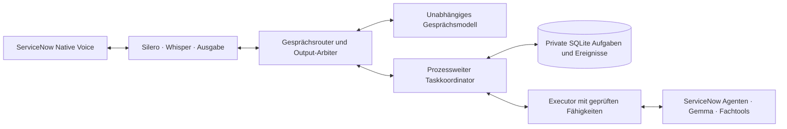

# Ansprechbarer ServiceNow Voice Assistant: verbindlicher Entwurf

23.10.2026. Der Nutzer beauftragt vertiefte Planung und vollständige Umsetzung des gewählten Ansatzes und delegiert die Modellwahl. Die Entscheidungen unten stammen vom Implementierer. Forschung, automatisierter Nachweis und produktive Qualifikation bleiben erkennbar getrennt.

## Erlebnis

Während ServiceNow arbeitet, hört die Gesprächsschicht weiter zu und reagiert auf Statusfragen, Verständnisfragen, Korrekturen und weitere Anliegen. Sprache ist unterbrechbar. Ein Orchestrator ordnet neue Aussagen einem Anliegen zu; ServiceNow bleibt der einzige fachliche Ausführer. Ein verspätetes Ergebnis gehört weiterhin zu seinem ursprünglichen Anliegen. „Hör auf zu sprechen“ ist kein Bestellabbruch. „Bestellung abbrechen“ ist zunächst ein Wunsch, kein Stornierungserfolg.

„Doch der erste November“ wird der offenen Datumsfrage zugeordnet oder bei mehreren möglichen Bezügen geklärt. Die Antwort unterscheidet ausdrücklich zwischen lokal gespeichert, am nächsten sicheren Punkt übergeben und nach verbindlicher Einreichung nur als Änderungswunsch aufgenommen. Ein WLAN-Anliegen darf nicht als Eintrittsdatum an den Laptop-Agenten geraten. Angenommene Aussagen verschwinden nicht aus einer Zwei-Plätze-Queue.

## Befund und Auswahl

Mikrofon und ASR sind parallel, `NativeCall.process_turns()` wartet aber auf `Dialog.turn()`. Die Bridge erlaubt eine ausstehende Anfrage. Aktives Gemma: concurrency1/context32768, mindestens18GiB Reserve. Silero-Geräuschreparatur und TURN bleiben erhalten.

| Ansatz | Entscheidung und Grund |
|---|---|
| Separate Text-Gesprächsschicht + Silero/Whisper/QwenTTS + asynchrone Tasks + Gemma-Facharbeit | Gewählt. Unabhängige Gesprächskapazität und kontrollierbare Fachaktionen; Sprachqualität bleibt vergleichbar. |
| Qwen3-Omni als Audiofrontend vor demselben Koordinator | Vergleichsadapter. Vorhandener Windows/HIP-Prototyp in REV-N: ca24,7GiB resident, warm Text0,38–0,80s; native TalkerRTF1,34–1,58 und langer Prefill. Keine ungemessene Aktivierung neben Gemma. |
| Modellnatives Duplex, etwa MiniCPM-o4.5 | Späterer Vergleich: lokale Gewichte unvollständig und Windows/AMD/Deutsch unqualifiziert. Kein stiller großer Download. |

Die aktuelle Qwen3-Omni-vLLM-Konfiguration beschreibt unterbrechbare VAD-Turns ohne kontinuierlichen nativen Input-KV. Qwen3.8-Omni-Cloud ist kein belegter lokaler Gewichtssatz. Windows/AMD ist nicht pauschal ausgeschlossen: eigener Prototyp und inzwischen AMD-Strix-Halo-WSL-Unterstützung existieren. Die konkrete Kombination zählt.

Lokales Inventar:142Gewichtsdateien/38Verzeichnisse. Gemma4-26B bleibt Fachmodell. Qwen3.8-27B+mmproj ist ein späterer Vision-Kandidat, Flash-Next87–92GiB keine kleine Gesprächsschicht. Vollständiges Qwen3-Omni25,66GiB. Qwen3.5-0.8B ist Base/Proposer. NPU-Qwen3-0.6B antwortet in652–908ms, trifft aber nur2/6 elementare deutsche Routingfälle: abgelehnt. Begrenzter neuer Kandidat Qwen3-4B-Instruct-2507-Q4_K_M (~2,33GiB), exakt gepinnte Revision/Hash und vorhandener llama.cpp-Build10690. CPU zuerst; getrennte Vulkan-Koexistenzmessung nur bei Bedarf. Modell wird erst nach tatsächlicher Deutsch-/Latenzprüfung aktiviert. Keine Lösung heißt automatisch „gut“, nur weil sie klein ist.

## Komponenten

**TaskStore:** SQLite WAL/foreign keys/Transaktionen; geordnete append-only Ereignisse, persistente Outbox/Inbox und unveränderliche Operationsidentität. Keine Bearer, Cookies oder Schlüssel. Private explizite Deployment-Datei; kein öffentlicher Ledger-Endpunkt. Annahme erst nach Persistenz. Gleiche utterance_id/Callback-ID ist nur bei identischem Binding und Inhalt idempotent. Abweichungen sind Konflikte.

**ConversationRouter:** deterministische eindeutige Status-/Audiosteuerung zuerst; sonst ein unabhängiger, begrenzter Modellvorschlag. Geschlossenes Schema: `status_query`, `clarification`, `amend_task`, `new_task`, `stop_speaking`, `cancel_task`, `uncertain`, `continue_task`; task_id und registrierter agent_alias dürfen nur aus dem gelieferten Kontext stammen. Keine vom Modell gewählten URLs, rohen Agent-/Tool-IDs oder Aktionen. Ungültig/mehrdeutig/zu groß/Timeout ergibt Rückfrage, keine erratene Änderung. Fachliche Daten werden nicht aus freiem Modelltext als bestätigt übernommen. Status, Fehler und sicherheitsrelevante Bestätigungen kommen aus Vorlagen und belegtem Zustand. Ein Modell darf bounded Gesprächserklärungen nur aus beigefügtem belegtem Verlauf vorschlagen; neue Fakten sind keine Evidenz.

**TaskCoordinator:** prozessweite Worker, Aufgaben getrennt von Anruf-Anbindung. Ein Worker pro belegtem Ausführungskontext, derzeit ein LegacyVA-Kontext. Keine zweite Nachricht an dieselbe beschäftigte VA-Unterhaltung. Weitere Anliegen werden benannt/geplant, aber kein unbewiesener Topicwechsel oder paralleler Agent behauptet. Der Orchestrator macht Wartestatus und fehlende Agentfähigkeit sichtbar. Maximal8Tasks und32ausstehende Aussagen je Anruf; Überlast wird ausdrücklich abgelehnt statt als angenommen markiert. Usertext<=4000Zeichen.

**OutputArbiter:** ein Sprecher, priorisierte begrenzte Ausgaben, Playback-Generationen. VAD/Audiostopp stoppt Ausgabe ohne fachliche Stornierung. ServiceNow-Ergebnisse werden vor Ausgabe gespeichert. Unterdrückte Ergebnisse bleiben für Status/Wiederholen erreichbar; eine Statusfrage darf künftige Fachantworten nicht dauerhaft stummschalten. Keine überholte Datumsfrage ungekennzeichnet nach Korrektur. TTS-Fehler lösen keinen neuen Fachaufruf aus. Generiert/gesendet/gehört werden getrennt; ohne Client-ACK nur als gesendet ausweisen.

**LegacyVAExecutor:** authentisierte aktuelle Cookie/CSRF-Bridge; busy, Callback-Korrelation, Terminal-Drain, owned cleanup und unklare Ergebnisse bleiben erhalten. `Dialog.turn()`-Ende bedeutet awaiting_input mit belegter Botantwort, nicht Bestellung succeeded. Originale Callertexte bleiben exakt; keine erfundenen Tool-/Userhistorien. Adapterfähigkeiten sind explizit, standardmäßig ausgeschaltet bis wire-qualifiziert.

Verbindungsaufbau blockiert die lokale Gesprächsschicht ebenfalls nicht. Eingaben können während `Dialog.open()` dauerhaft angenommen werden, der Worker sendet erst nach tatsächlicher Eingabebereitschaft. Nach1000ms ohne Fachbereitschaft kommt einmal eine ehrliche lokale Verbindungsrückmeldung, generation-geprüft und unterbrechbar. Das ist keine vorgezogene fachliche Begrüßung und wird nicht als Botverlauf erfunden. Backendbegrüßung/Sprachauswahl behalten ihre Reihenfolge; ein gescheiterter Aufbau erzeugt einen belegten Fehler und keine vermeintlich gestartete Aufgabe. Erste-Audio-/ICE-/Admission-/Backendbereit-Zeit getrennt messen.

**QualifiedServiceNowExecutor:** eigener nachgewiesener Task-/Operationsvertrag für unabhängige Agenten und Versionierung. Kein KAA-Bypass, keine geratenen Header oder erfundenen IDs. Full-mode-Aktivierung ohne Identität/Fencing/Lifecycle schlägt fehl. Responsive Legacy bleibt ausdrücklich eingeschränkt und wird nicht als vollständige parallele Fachorchestrierung etikettiert.

## Persistenz und Lebenszyklus

Task: task_id,parent_task_id,scope_id,instance_id,assistant_id,optional_verified_principal,call_id,call_generation,agent_alias,registry_revision,objective,context_version,state,open_question,result_version,created_at,updated_at. Operation: operation_id,task_id,utterance_id,context_version,immutable_payload,dispatch_state,request/execution_refs,receipt,evidence. Event: event_id,sequence,task_id,operation_id,type,context_version,payload,source,fingerprint. Opaque UUIDs; bounded JSON.

Zustände: queued,running,awaiting_input,ready_to_commit,committing,succeeded,failed,cancel_requested,cancelled,outcome_unknown. Atomare validierte Übergänge und Eventeinfügung. Spätes Ergebnis darf terminalen Zustand nicht zurücksetzen. Eine Operation ist unsubmitted oder submitted/accepted/settled/unknown; HTTP202 ist kein Fachabschluss.

Native SDK belegt Assistant/Agent, derzeit keinen behaltenen Principal. `agent_operator`, Demoalias und Anzeigename sind keine Identität. Legacy ist call-scoped, keine Wiederaufnahme über Anrufe. Neue Anrufe erhalten keine alten privaten Inhalte. Worker gehören dem Prozess und beobachten nach Hangup weiter; Anbindung endet sofort und sendet keine externe Benachrichtigung. Angenommene, noch nicht eingereichte Aussagen bleiben nach Detach dauerhaft suspendiert; sie dürfen auch bei frei werdendem Worker nicht automatisch starten. Ein bereits verbindlich autorisierter unabhängiger Full-mode-Auftrag dürfte nur unter gesondert belegter Plattformautorität weiterlaufen. Diese ist im aktuellen Legacyvertrag nicht vorhanden. Restart: dispatched Legacy wird outcome_unknown und nie automatisch erneut gesendet; ungelöste Reservierung blockiert weitere Fachausführung, bis konkrete Klärung vorliegt. Die initiale Implementierung hat explizite Reconciliation statt erfundener Crash-Recovery.

## ServiceNow-Autorität

V2-Projektion ergänzt nur opt-in: geprüfter Principal, Assistant, autorisierte Agent-IDs, Ablauf und Registryrevision. V1-Settings/Legacyarray bleiben kompatibel. Registry ist Schnittmenge aus Plattformrechten und Deploymentfreigabe. Keine Rollen aus lokalem JSON rekonstruieren; Agent-Widerruf/Expiry vor neuen Schritten und Writes erneut prüfen. Verbindliche Bindung: ein authentisierter Plattformaufruf erstellt die Aufgabe mit dem tatsächlich geprüften Plattformprincipal und dem Assistant; eine serverseitig gespeicherte Callbindung/Proposal-ID referenziert ausschließlich diese Aufgabe. Bestätigung erfolgt auf dem unabhängig authentisierten Kontrollkanal gegen genau diese Proposal-ID und Revision. Die lokale ASR/Modellinterpretation allein erzeugt keine fachliche Bestätigung. Ohne diesen wire-qualifizierten Zusammenhang bleibt Full-mode gesperrt; Legacy erhält keine neue Identitäts- oder Bestellbefugnis.

Eigene append-only Revisionstabelle mit UNIQUE predecessor_slot=(task_id,expected_revision): Amendment und Commit konkurrieren um denselben Head; nur eine Einfügung gewinnt. Amendment hebt Version und Bestätigung auf; Commit ist unveränderlicher Fence, spätere Korrektur ein eigener Änderungswunsch. UNIQUE operation_id verhindert doppelte Dispatchclaims. Aufgabe/Owner/Proposal/Bestätigung/Hash werden serverseitig aus gespeicherter Bindung geprüft, nicht aus Modellparametern. Claim muss vor Fachdispatch dauerhaft sein; kein automatisches Reclaim unklar gestarteter Aktionen. Transaktionsgrenzen und stabile operation->RITM-Verknüpfung sind live zu prüfen. Unique Insert allein beweist kein genau-einmal.

Bestehende sichere Requester-/Manager-/Katalog-/CartJS-Prüfungen bleiben. Ähnliche jüngste Bestellung ist kein Idempotenzschlüssel. Geprüftes Paket plus Race-/Vertragstests sind Lieferumfang, aber keine livequalifizierte Fähigkeit. ContextVariables werden nicht ohne Nachweis als vertrauenswürdige Toolinputs behandelt. Native agents/store bleiben KAA-geschützt. Background-/A2A-Adapter erst mit installiertem tatsächlichem Vertrag aktivieren.

## Sprache, Modelle und Zusatzmodalitäten

SileroCPU mit Original-PCM/Preroll und kurzen Antworten bewahren. Kein „vielen Dank“-Blacklist oder harter Personenname. Whisper bleibt Vergleichsbasis; Contextterms aus autorisiertem Kontext, kein Erzwingen fehlender Sprache. Namen, Datumswechsel, Buchstabieren, leise Stimme, Ja/Nein, Rauschen und TTS-Echo vergleichen. AEC braucht tatsächliche Clientprüfung. Endpointstille/ASR/Routing/TTS/erstes Audio separat messen;1200msStille erlaubt kein unter1s-Gesamtversprechen. Semantisches Endpointing optional nach belastbarer Basis, pinnen und Timeoutfallback.

Gesprächsmodell: eigener loopback-authentisierter OpenAI-kompatibler Dienst, eigener Owner, unabhängig vom Gemma-Gateway; Kontext<=4096, concurrency1,max128Outputtokens, Timeout2s für Routing. Größere Rückfrage/Erklärung nur mit begrenztem Budget und sofortigem lokalen Status. Deutschkorpus vor Aktivierung; bei Ablehnung keine ungeprüfte freie Gesprächsfähigkeit behaupten. Speicherreserve>=18GiB, keine blinde Parallelitätsänderung.

Omni-Fähigkeiten einzeln: continuous_audio_input,turn_commit_required,barge_in,native_turn_policy,native_audio_output,text_context_updates,image_input. REV-N-WebSocket als Vorlage wiederverwenden, dessen Dienste nicht ändern. Nur mit gepinnter aktueller Evidenz freigeben; Text-/Audiopfad, Kontextupdate, Cancel und verlorene Chunks testen. Peakmemory, Echtzeit-Audio und Deutsch neben Gemma sind Gates.

Vision: tatsächlicher autorisierter Anhang+Frage+Taskbindung, separater zeitgestempelter Auftrag. Aktueller Native-Telefonkanal hat keinen belegten Bildpfad. Keine behauptete Kamera oder Dummy-Visionfähigkeit; vorhandene Gewichte sind unqualifizierte Assets bis realer Anhang/Runtime-Test. Große Visionmodelle bedarfsweise über Kapazitätsplanung, nicht ständig parallel laden.

## Abnahme und Aktivierung

Automatisiert: gehaltene Fake120sFacharbeit plus lokale Status/Korrektur/neuesAnliegen, kein zweiter busyVA-Aufruf;32angenommene Aussagen ohne stillen Verlust; doppelte/vertauschte/späte Events; Korrektur vor/nachFence; unklarer Submit/keinRetry; Hangup/InputLoss/Restart; neuerAnrufIsolierung; staleAudio; TTSFailure; falschesModellJSON/Injection; Agentrevocation/Expiry; Owner-/Speicherkonflikt. Virtuelle fachliche Zeit, echte Eventloop-Reaktionsprüfung.

Modell:>=120Routingfälle+40belegteFormulierungen, criticalWrongTask/falscherAbbruch/erfundenerErfolg=0; Ambiguität muss enthalten. Modell/Runtimehash, p50/p95/max, Samplezahl und Grenzen dokumentieren. Physisch: warme ASR-final->hörbaresAudio Ziele p50<1s/p95<2s unter Last; echter Barge-in p95<300ms. Bis Messung nur Ziele. Gleiches Namens-/Noise-/Mikrofonkorpus, kein synthetischer ASR-Erfolg als echte Mikrofongüte.

NativeBaseline465Tests:1failure+26errors; Namen vergleichen, keine neuen Fehler verstecken. Arbeitsbaum besitzt viel Vorarbeit: Snapshot, nur neue Dateien/baseline-relativeHunks stagen. Desktopstarter idempotent, nur gewählter qualifizierter Zusatzdienst. Vor Aktivierung idle/Owner/Config/Health prüfen, private Backups, fokussierter Reload, Rollback und Telefonprüfung. Unklare Fachreservierungen überleben Reload.

## Quellen

Detaillierte lokale Belege im Taskworkspace duplex-implementation-20261023: local-model-inventory.md/json,runtime-reuse.md,qualification.md/json,multimodel-research.md,servicenow-contract.md. Hauptquellen: [ServiceNow VoiceFAQ](https://www.servicenow.com/community/servicenow-otto-articles/ai-voice-agents-are-here-autonomous-service-that-delights/ta-p/3448126), [BotAPI](https://www.servicenow.com/docs/r/api-reference/rest-apis/bot-api.html), [BackgroundAgents](https://www.servicenow.com/docs/r/intelligent-experiences/configuring-ai-agents.html), [A2A](https://www.servicenow.com/docs/r/intelligent-experiences/secondary-agent.html), [QwenOmni](https://github.com/QwenLM/Qwen3-Omni), [Duplex](https://docs.vllm.ai/projects/vllm-omni/en/latest/serving/full_duplex_api/), [MiniCPM](https://huggingface.co/openbmb/MiniCPM-o-4_5), [AMDWSL](https://rocm.docs.amd.com/projects/radeon-ryzen/en/latest/docs/install/installryz/wsl/howto_wsl.html), [SmartTurn](https://github.com/pipecat-ai/smart-turn).
